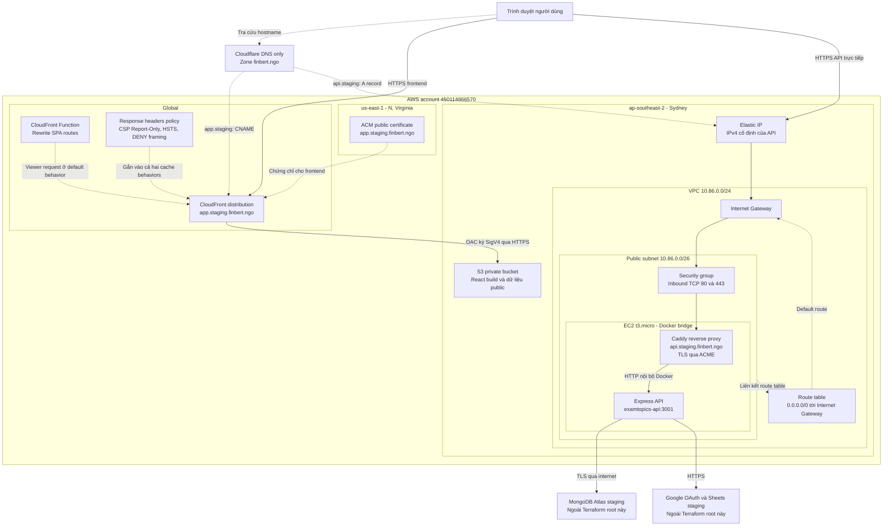
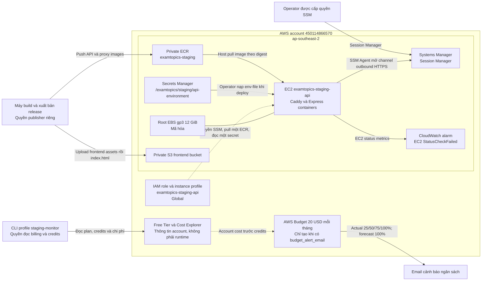

# Kiến trúc AWS staging và cách review trên Console

Sơ đồ mô tả **thiết kế trong Terraform**, đối chiếu ngày 22/11/2026, cho account `450114866570`. Đây không phải bản kiểm kê tài nguyên đang chạy. Preflight đã ghi trong runbook chỉ xác minh identity của profile `staging-plan`, AMI Sydney và chứng chỉ ACM; tài liệu này không xác nhận Terraform đã được apply thành công hay ứng dụng đã hoạt động.

Region chính: **Asia Pacific (Sydney), `ap-southeast-2`**. CloudFront và IAM là dịch vụ global; chứng chỉ frontend nằm ở **N. Virginia, `us-east-1`**. Giữ Render production hoạt động riêng trong lúc nghiệm thu staging.

## 1. Luồng truy cập của người dùng

Mũi tên liền biểu diễn luồng truy cập/dữ liệu; mũi tên nét đứt biểu diễn DNS hoặc quan hệ cấu hình. Các khối Caddy/API là phần cần cài đặt sau Terraform apply.

Đọc luồng theo hai đường riêng:

1. **Mở frontend:** trình duyệt gọi CloudFront; CloudFront lấy file từ S3 private bằng OAC. JavaScript React chạy trong trình duyệt.
2. **Gọi API:** JavaScript gọi trực tiếp `https://api.staging.finbert.ngo`; request đi tới Elastic IP, qua Internet Gateway và security group, vào Caddy rồi Express. CloudFront không proxy API trong thiết kế này.

Cloudflare chỉ trả lời DNS, không nằm trên đường truyền HTTP vì dùng DNS only. Chứng chỉ ACM chỉ phục vụ CloudFront; Caddy tự cấp và gia hạn chứng chỉ API. OAuth còn có redirect giữa trình duyệt, Google và API; mũi tên Google trong sơ đồ trên chỉ tóm tắt phụ thuộc bên ngoài.

Subnet là public nhờ route tới Internet Gateway. Terraform tắt tự cấp public IP trên subnet/instance rồi gắn một Elastic IP riêng. API truy cập Atlas, Google, ECR và SSM qua đường internet này; S3 không nằm trong VPC. Sơ đồ rút gọn đường outbound, không vẽ lại từng kết nối qua Internet Gateway.

## 2. Quản trị, image, secrets và monitoring

Các kết nối dưới đây không phải đường đi của mỗi request người dùng. Secrets được operator lấy qua instance role khi cấu hình container, không lấy lại từ Secrets Manager cho từng request.

CloudWatch alarm hiện **không gắn SNS/email action**, chỉ hiển thị trạng thái. Nó kiểm tra tình trạng instance/nền tảng EC2, không kiểm tra HTTP, OAuth hay MongoDB. Log containers xoay vòng trên ổ local; Terraform chưa cấu hình CloudWatch Logs. Budget là cảnh báo, không phải hard spending cap. Với bộ inputs đã ghi trong runbook, chưa có `budget_alert_email`, nên Budget không được tạo.

## 3. Bản đồ review trên AWS Console

Đăng nhập đúng account `450114866570`. Với dịch vụ regional chọn Sydney; riêng ACM chọn N. Virginia. Tên và thiết lập dưới đây là **giá trị mong đợi sau apply**, không khẳng định tài nguyên đã tồn tại. Nếu cần ID được AWS sinh ra, đối chiếu Terraform outputs sau apply.

| Thành phần | Console / region | Tên hoặc output để tìm | Điểm cần đối chiếu |
| --- | --- | --- | --- |
| VPC | VPC / Sydney | Name `examtopics-staging` | CIDR `10.86.0.0/24`, DNS support và DNS hostnames bật |
| Subnet | VPC → Subnets / Sydney | Name `examtopics-staging-api` | CIDR `10.86.0.0/26`, thuộc đúng VPC; tự cấp public IPv4 tắt |
| Internet Gateway và route table | VPC / Sydney | Name `examtopics-staging` và `examtopics-staging-api` | Gateway gắn đúng VPC; subnet gắn route table có `0.0.0.0/0` tới gateway |
| Security group | EC2 hoặc VPC / Sydney | Group `examtopics-staging-api` | Inbound từ `0.0.0.0/0` chỉ TCP 80/443; egress TCP 443 và 27015–27017; không mở SSH/3001 |
| EC2 | EC2 → Instances / Sydney | Name `examtopics-staging-api`, output `api_instance_id` | `t3.micro`, AMI `ami-09a2f74ce8538e414`, IMDSv2 required, hop limit 1, CPU credits standard |
| EBS | EC2 → Volumes / Sydney | Root volume của instance | gp3 12 GiB, encrypted, delete on termination; chưa có backup snapshots trong Terraform |
| Elastic IP | EC2 → Elastic IP addresses / Sydney | Name `examtopics-staging-api`, output `api_public_ipv4` | Một IPv4 gắn đúng instance; đối chiếu API DNS và Atlas allowlist `/32` |
| Instance role | IAM → Roles / Global | `examtopics-staging-api`, inline policy `staging-runtime` | Trust EC2; quyền SSM và ECR auth cần resource `*`; pull chỉ repository staging, GetSecretValue chỉ secret staging |
| ECR | ECR → Private repositories / Sydney | `examtopics-staging`, output `release_repository_url` | Immutable tags, scan on push; giữ 10 API tags, 3 proxy tags; untagged hết hạn sau 7 ngày |
| Secrets Manager | Secrets Manager / Sydney | `/examtopics/staging/api-environment` | Terraform chỉ tạo metadata; secret value do operator nạp riêng. Review metadata, không chụp/copy giá trị bí mật |
| S3 | S3, bucket ở Sydney | `examtopics-staging-web-450114866570`, output `frontend_bucket` | Block Public Access bật cả 4; versioning; SSE-S3; chỉ CloudFront distribution đúng được GetObject; bắt buộc TLS |
| CloudFront | CloudFront → Distributions / Global | Alias `app.staging.finbert.ngo`, output `frontend_distribution_id` | Origin là S3 REST regional endpoint, dùng OAC; redirect HTTP→HTTPS; chứng chỉ đúng ARN |
| Cache và route frontend | CloudFront → Distribution behaviors / Global | Default và `/assets/*`; function `examtopics-staging-frontend-route` | Default dùng CachingDisabled và viewer-request function; `/assets/*` dùng CachingOptimized và compression; cả hai dùng custom headers policy |
| Headers frontend | CloudFront → Policies / Global | `examtopics-staging-frontend-headers` | CSP Report-Only cho API staging, HSTS, frame DENY, nosniff; không hiểu nhầm CSP đã được enforce |
| ACM | Certificate Manager / **us-east-1** | ARN suffix `2f47ff51-c8d0-489d-9814-6082a5fe3fea` | ISSUED, SAN `app.staging.finbert.ngo`, export disabled, DNS validation record được giữ |
| SSM | Systems Manager → Session Manager / Sydney | Instance từ `api_instance_id` | Instance online sau khi Agent và network sẵn sàng; SSM không yêu cầu inbound SSH |
| CloudWatch | CloudWatch → Alarms / Sydney | `examtopics-staging-api-instance-status` | `AWS/EC2`, `StatusCheckFailed`, Maximum, 300 giây, 2 periods, threshold ≥1; không có notification action |
| Budget | Billing and Cost Management → Budgets / Account | `examtopics-staging-monthly`, nếu bật | USD 20/month; exclude credits/refunds; 4 actual alerts + 1 forecast alert |
| Account plan và credits | Billing and Cost Management / Account | Free Tier và Cost Explorer | FREE, ACTIVE, ngày hết hạn, credits ≥USD 20; tổng chi phí trước credits và thời điểm báo cáo |

CloudFront giữ `PriceClass_100`; origin ở Sydney không có nghĩa frontend được phục vụ từ mọi edge location châu Á/Úc. Xem phạm vi tại [AWS PriceClass](https://docs.aws.amazon.com/cdk/api/v2/docs/aws-cdk-lib.aws_cloudfront.PriceClass.html?lang=python).

## 4. Thành phần nào Terraform quản lý?

| Nhóm | Terraform root này quản lý | Cần operator chuẩn bị/triển khai riêng |
| --- | --- | --- |
| Network và compute | VPC, subnet, gateway, routes, security group, EC2, EBS, EIP, instance role/profile | Docker, Caddyfile, containers, updates của host, kiểm tra SSM Agent |
| Frontend | S3 và bucket policies, CloudFront distribution/OAC/function/headers | React build và upload assets/index.html |
| Release và secrets | ECR + lifecycle, Secrets Manager secret metadata | Push image, chọn digest, secret value và secret version |
| HTTPS và DNS | Tham chiếu ACM ARN đã có | ACM issuance/validation; Cloudflare records; TLS API do Caddy cấp |
| Database và Google | Không tạo Atlas hoặc Google resources | Atlas staging/user/allowlist, OAuth callback, Sheets fixture |
| Monitoring | EC2 status alarm; Budget khi bật input | Đọc Free Tier/credits/spend; dashboard hoặc HTTP monitoring nếu sau này có đề xuất riêng |
| Quyền operator | Instance runtime role ở trên | Các CLI profiles `staging-plan`, `staging-monitor`, deployment, publisher và SSM access |

Không có NAT Gateway, ALB/NLB, Route 53 hosted zone, RDS, ECS/EKS hay remote Terraform backend trong root này. Không cần tạo thêm các dịch vụ đó để sơ đồ “đủ thành phần”. Terraform state đang local; giữ an toàn state và worktree, không commit state hoặc tự di chuyển backend.

## 5. Thứ tự review và điều kiện sẵn sàng

1. **Trước apply:** review plan, account/region, IAM, Free plan/credits, chi phí và AMI/ACM. Đọc [cost estimate](aws-staging-costs.md) và [approval policy](../policies/aws-deployment-approval.md).
2. **Sau apply:** review VPC → subnet/routes → EC2/EIP/security group/EBS → IAM/SSM → ECR/secret → S3/CloudFront → alarms. Chưa có app chạy chỉ vì infrastructure đã được tạo.
3. **Sau publish và host setup:** review Cloudflare records, HTTPS ở cả hai hostname, frontend routes, API, OAuth, MongoDB transactions và Sheets staging theo [runbook](aws-staging-runbook.md).
4. **Sau nghiệm thu:** theo dõi CPU credits, đĩa, chi phí trước credits và credits còn lại. EC2 stop không xóa EBS/EIP và các chi phí lưu trữ/liên quan có thể còn tiếp tục.

Console review không yêu cầu sửa cấu hình. Với tài nguyên Terraform quản lý, thay đổi trong Console có thể tạo drift; đề xuất thay đổi qua code và saved plan được review. Mọi thao tác thay đổi AWS/Cloudflare/Atlas/Google cần phê duyệt riêng theo phạm vi; sơ đồ này không phải phê duyệt deployment. Single EC2 là một điểm lỗi duy nhất, không có load balancing hay failover tự động trong thiết kế staging này.

Nguồn đối chiếu: [Terraform staging](../../infra/terraform/staging), [runbook](aws-staging-runbook.md), [cost guardrails](../policies/aws-cost-guardrails.md). Tài liệu không đọc state/tfvars và không thực hiện AWS calls để kiểm kê live.
