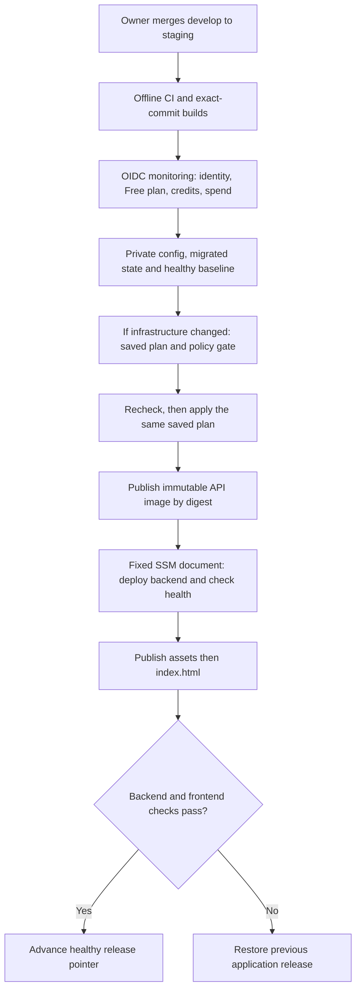

# CI/CD AWS staging: bootstrap, activation and operation

## Authorization and lifecycle

This guide implements the owner-approved design: a reviewed PR from `develop` merged into `staging` by the repository owner starts an automatic release of that exact merge commit. The repository is `finbertmds/examtopics` (ID `1035462381`), AWS account `450114866570`, region `ap-southeast-2`. Render production on `master` is a separate release path.

The workflow is **not activated by committing these files**. It requires a separately approved bootstrap and an explicit GitHub Environment activation flag. Review [the canonical exception](../policies/aws-deployment-approval.md#exception-activated-owner-merged-staging-cicd), [cost rules](../policies/aws-cost-guardrails.md), and the [architecture](aws-staging-architecture.md) first. Chat agents do not gain standing permission to run AWS or GitHub write commands from this exception.



Only deployment-relevant changes call AWS. Documentation-only PRs run CI. Terraform is not reapplied just because application source changed. A later application release must include any earlier undeployed infrastructure delta when comparing against the last healthy release. Newer documentation-only commits must not invalidate an otherwise valid pending application release.

## 1. Prepare code and branches

1. Review the local diff and offline test evidence. Integrate the current Sydney changes and CI/CD implementation into `develop` through a separately approved PR/merge; do not deploy from this implementation branch.
2. Refresh `origin/develop` and record its exact SHA. Create remote `staging` from that SHA only after explicit approval for the branch creation/push. If it already exists, stop and compare history rather than overwrite it.
3. Protect `staging`: require PRs and the stable `CI required` check; block force-push/deletion and direct pushes, including owner bypass of required CI. Limit branch update/merge authority to the owner through repository access/rulesets. With a single owner reviewing their own PR, required approving reviews is `0`; this must not be described as an independent approving review.
4. Set up environment `aws-staging`, restricted to `staging`, with no additional deployment review gate. Keep `STAGING_CICD_ENABLED` false until every bootstrap step below is complete. The workflow independently checks that the merge is same-repository, head `develop`, base `staging`, and merger ID equals repository owner ID.

Branch protection/environment changes are GitHub mutations and are not executed by this guide. Record the exact proposed settings before requesting authorization. Verify protections from GitHub after applying them; a YAML check can reject an unauthorized release but cannot prevent an unauthorized branch update by itself.

## 2. Anchor the trusted controller and bootstrap separately

The entrypoint calls `.github/workflows/staging-release.yml@aws-staging-controller-v1`. Before publishing this tag, separately approve and configure an exact-tag ruleset restricting **creation, update and deletion** to the operator. Publish it only at the reviewed controller commit and record its peeled 40-character commit as `controller_sha`. Never move this tag. Controller upgrades require a new reviewed version/tag, matching OIDC trust and baseline configuration updates. The controller and privileged actions are pinned; candidate application code runs only in jobs without AWS credentials. Artifact downloads use the build job’s immutable artifact IDs. A separate fresh runner scans that exact API archive without executing candidate build commands; release requires scan success and bounds the archive before loading it.

Customize the repository OIDC subject to include `repo`, `context` (the environment) and `job_workflow_ref`; include `job_workflow_sha` too if supported. Verify the actual emitted subject in a credential-free diagnostic, without printing the JWT. Bind the exact value to bootstrap `github_subject`, ending in the trusted reusable workflow’s protected tag ref, optionally followed by its SHA. A plain environment-only subject is rejected. Preserve repo/owner/actor IDs and staging-ref restrictions. The repository subject customization also affects other OIDC consumers and requires separate review. [AWS claim mapping](https://docs.aws.amazon.com/IAM/latest/UserGuide/reference_policies_iam-condition-keys.html), [GitHub OIDC configuration](https://docs.github.com/en/actions/how-tos/secure-your-work/security-harden-deployments/oidc-in-aws).

The bootstrap Terraform root is separate from the staging application root and must be run by a human-controlled, short-lived identity after review of its exact saved plan. Its outputs provide the role ARNs, state/release bucket names and deployment document identifiers needed below.

- **State bucket:** private, encrypted, versioned, TLS only; exact application key `staging/terraform.tfstate`, with S3 locking on its `.tflock` object. No DynamoDB table. Planning can manage the lock but cannot overwrite application state; apply can write only the approved application state key.
- **Release bucket:** private, encrypted, versioned; `baseline/` is human/bootstrap controlled and read-only to CI. CI can write only release artifacts/records under `releases/`.
- **OIDC:** verify the repository's actual subject format; do not assume legacy name-only subjects. Trust the exact staging environment/branch and repo identity. Create separate monitoring, planning, applying and publisher/SSM roles. Never store access keys as GitHub secrets.
- **Runtime boundary:** manually attach the fixed boundary to the EC2 instance role as part of the approved baseline setup. CI does not receive permission to edit runtime IAM policies or its own control-plane roles, trust, boundaries, state bucket policies or bootstrap state.
- **SSM document/helper:** use the bootstrap-created fixed document, pin its numeric version and installed helper checksum. Install the reviewed helper root-owned at `/usr/local/sbin/examtopics-deploy`; the workflow cannot upload arbitrary shell commands instead. Existing Docker, Caddy config, network and persistent volumes are prerequisites.

Creating an OIDC provider, buckets, IAM resources or SSM document, attaching the runtime boundary and installing host tooling each require their own exact authorization. Do not create/join Organizations, enable Control Tower, change the Free plan or introduce a paid runner/service as a shortcut.

## 3. Migrate existing state without recreating infrastructure

An operator must identify the authoritative local state, securely back it up and perform the reviewed backend migration. Agents must not open or print `*.tfstate*` or `*.tfvars*`. The application root uses a partial S3 backend; backend bucket/key/region are supplied during initialization, not credentials.

Do not run CI against an empty new backend and approve a plan that recreates the already-running stack. Compare a private post-migration plan against the existing resources; expected baseline setup may include the reviewed runtime boundary and ECR retention adjustment. Complete that separately approved baseline apply first, then freeze the resulting resource inventory. Retain the old state backup securely and designate the new backend as authoritative; do not keep applying from the old local state.

State migration is not performed automatically by the workflow. Do not use automatic `force-unlock`. Keep state, plan and private inventory exports out of public GitHub logs, PR comments and ordinary downloadable workflow artifacts.

## 4. Freeze configuration and seed a healthy release

Use `infra/cicd/staging.example.json` as the shape for the non-secret configuration. Every all-zero identifier/digest and the `ffffffff…` controller SHA in the example is a placeholder, not a deployment value. Fill reviewed outputs, exact image/secret versions, cost/storage caps and Terraform variables without copying a local env/tfvars file into Git. Backend secret payloads must remain in Secrets Manager and on the host.

Store the approved configuration at `baseline/config.json` and the sanitized resource inventory at `baseline/inventory.json` in the private release bucket. Configuration must match the baseline exactly. The application baseline binds addresses, types, IDs and protected configuration, not merely resource counts. Empty or missing baseline/state is a blocker. The inventory capture tool is for an operator-provided private JSON export; only its sanitized output is uploaded, never the raw export.

Capture the currently healthy deployed application before the first automatic release: commit, API/proxy ECR digests, exact secret Version ID, frontend build/manifest and S3 index Version ID. Use the release tool's offline `prepare-baseline` command to prepare its artifacts; separately approve the operator's uploads. The seed consists of a full recoverable frontend archive, a manifest and `releases/last-known-healthy.json`. Do not invent a commit or label an untested release healthy to bypass the prerequisite.

Keep custom Secrets Manager staging labels on both referenced secret versions so that unlabelled-version cleanup cannot remove rollback configuration; release credentials cannot rotate secrets. Keep the current and previous healthy images/builds recoverable. Tagged ECR images no longer expire automatically by count because ten failed builds could otherwise remove a healthy rollback image. Instead, CI enforces storage limits and stops before publishing beyond them. Cleanup of unreferenced artifacts is a separately reviewed operation; never delete images referenced by healthy manifests. Existing untagged-image cleanup remains separately defined in Terraform.

## 5. Configure GitHub Environment and activate

Create only non-secret environment variables for resource identifiers/configuration and OIDC role ARNs. Values must be derived from approved bootstrap outputs and the frozen config:

| Variable | Purpose |
| --- | --- |
| `STAGING_CICD_ENABLED` | Set to `true` only after all activation checks |
| `STAGING_CONFIG_JSON` | Exact approved JSON matching private `baseline/config.json` |
| `AWS_STAGING_MONITOR_ROLE_ARN` | Billing/Free Tier reads only |
| `AWS_STAGING_PLAN_ROLE_ARN` | Resource reads, state read and scoped lock access |
| `AWS_STAGING_APPLY_ROLE_ARN` | Approved bounded updates and exact state-key write |
| `AWS_STAGING_DEPLOY_ROLE_ARN` | Staging publication and fixed SSM document only |

No secret payload, database URI, Google private key, AWS access key or token belongs in this table. Verify OIDC claims/trust and role permissions before activation; a plausible role name is not proof of least privilege.

Approve the activation as a separate GitHub configuration operation after the following are recorded: branch restrictions, role trust, state migration, baseline/config equality, healthy rollback seed, Docker/Caddy/SSM health, Free-plan expiry and credits, gross spend, updated CI/storage cost assumptions, security review and QA results. Then merge a canary PR through `develop` → `staging` and monitor that run.

## 6. What happens on each release

1. CI validates all components and the exact source commit without AWS credentials; build artifacts contain only the frontend build and backend image, never state/plan or runtime secrets.
2. Monitoring verifies identity, active Free plan, expiry, USD credits ≥20 and reported gross month-to-date spend excluding Credit/Refund. Deterministic decimal calculations project remaining-month runtime plus billing-lag/deployment reserves; failed or incomplete billing blocks writes. Cost Explorer API requests themselves cost money and must stay in the reviewed deployment reserve.
3. Before lease acquisition or apply, validate the frontend archive, rollback artifacts/dependencies, local AMD64 API image and ECR storage inventory. Planning verifies the remote state and human-owned baseline, then checks the cumulative deployment delta from the last healthy release. Infrastructure changes produce a saved plan; only explicitly supported updates inside the frozen envelope pass. Unknown resources/prices, create/delete/replacement, IAM/security drift or capacity changes stop the run. The trusted controller assembles Terraform from its own reviewed root and lockfile; the only candidate infrastructure source currently accepted is `infra/terraform/staging/frontend-route.js` (regular file, at most 10 KiB). HCL/provider/lockfile/enforcement changes require a separate controller upgrade. App-only releases still run a live **read-only refresh-only plan** to reject drift, without applying it. Extend the baseline/model through a new manual review rather than editing it with workflow credentials.
4. Immediately before a write, recheck target/credits and that no newer deployment-relevant merge superseded the candidate. Apply the exact policy-checked saved plan on the same ephemeral runner after switching to apply credentials. No auto-approval flag replaces review; this specific activated workflow's merge authorization and enforced gates are the approval mechanism.
5. Recheck ECR inventory before pushing. Aggregate current and noncurrent S3 object versions across frontend/releases; reserve three maximum frontend archives plus metadata for a new release and rollback, and stop above the approved cap. Bound inventory pagination; retained artifacts never grow without checks. Publish the API image with an immutable commit tag and deploy its ECR digest. EC2 pulls before stopping containers, obtains the pinned secret version through its own role, checks required runtime configuration and internal dependency readiness, and preserves Caddy storage.
6. After backend checks pass, publish content-hashed assets before replacing `index.html`. Verify frontend content and its public asset(s), HTTPS and API connectivity. Public `/health` is intentionally 404; that response alone is not proof of API readiness. The API root must also return Express’s exact not-found JSON and a valid request UUID, demonstrating that Caddy reaches the backend.
7. Only when all checks pass, record the release and atomically advance the healthy pointer. Record target, merge SHA, images, secret version, frontend archive/manifest/index version and results without dumping secrets or raw command output.

Before each artifact, backend, frontend, pointer or rollback phase, the trusted controller obtains a fresh short-lived monitoring session using its OIDC identity, checks Free-plan/credits/costs, and rechecks the lease and baseline digest. Monitoring credentials are confined to child processes; runtime secrets never pass through GitHub.

Supersession is checked immediately before acquiring the lease. Once reserved, finish or reconcile that release rather than abandoning an infrastructure/application transition when a newer merge arrives.

The whole release is serialized. Do not cancel an active apply or overlap host replacements. The pipeline must account for superseded/queued runs so skipped commits cannot silently lose an infrastructure change. Failed infrastructure apply is an incident, not permission to retry blindly. Inspect current state under a separately approved investigation before deciding how to proceed.

## 7. Rollback and failure handling

Application failure triggers restoration of the previously verified manifest: exact backend/proxy digests, secret version and frontend build/index. No database migration, Terraform inverse apply or resource deletion is included. An SSM timeout, cancellation, polling loss or unknown command outcome stops automation: do not cancel remotely or start a second command. Uncertain frontend PUT outcomes also stop automation without rollback writes. Operator reconciliation must establish that remote work has stopped before any separately approved recovery. Host locking prevents simultaneous replacements.

The conditional `releases/in-progress.json` lease is removed only after a successful healthy-pointer update. Failure/cancellation leaves it in place and blocks all later releases, including after a successful rollback. An operator must investigate remote command status, state, containers and frontend/pointer consistency, then separately approve conditional lease removal against its observed ETag. Never blindly clear the lease or force-unlock Terraform.

Keep the previous healthy pointer unchanged if deployment or rollback fails. If an artifact is missing, IAM/billing verification fails, targets disagree or the baseline is incomplete, stop without attempting alternate credentials. Secret rotation, DNS, Atlas/Google changes and incompatible schema changes require their own plan; backward compatibility with the previous frontend/backend is a release prerequisite.

## Offline validation

See the [local security and QA evidence](../audit/aws-staging-cicd-review.md) for executed checks and activation blockers.

Inspect the test files first; they use fake AWS/Docker responses and temporary local fixtures. Ordinary validation does not read the operator's state, env or tfvars and does not call AWS.

```sh
python3 -m unittest discover -s infra/cicd/tests -v
terraform -chdir=infra/terraform/staging fmt -check -recursive
terraform -chdir=infra/terraform/bootstrap fmt -check -recursive
```

With locked providers installed, run `validate` and `test` in both Terraform roots without AWS credentials and with `init -backend=false -input=false -lockfile=readonly` if initialization is needed. Provider downloads are public network operations; they must not initialize a remote backend. Run actionlint on all three changed workflows and Bash syntax checks on the deployment helper. A sandbox may need permission for the provider's local Unix socket; that does not justify adding AWS credentials.

Record actual results, including NOT RUN reasons, in the delivery. No local test or reviewer verdict authorizes bootstrap, activation, a push/merge or production deployment.
