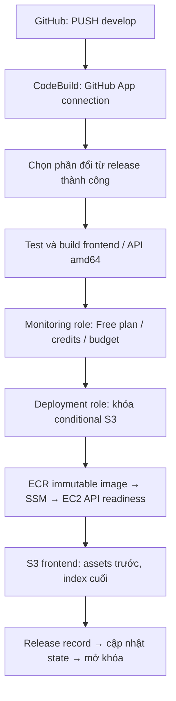

# Deploy develop bằng CodeBuild và GitHub webhook

Luồng này thay phương án GitHub Actions OIDC. AWS CodeBuild trực tiếp nhận GitHub webhook, lấy source qua GitHub App/CodeConnections, build/test rồi publish staging. Không cần Identity providers, AWS access keys trong GitHub, CodePipeline, CodeDeploy hoặc runner trên EC2. GitHub Actions CI/Render hiện tại vẫn độc lập.



Frontend-only bỏ qua ECR/SSM; backend-only bỏ qua frontend upload. Nếu cả hai đổi, mọi test/build phải thành công trước publication và API readiness phải thành công trước frontend. API mới cần tương thích frontend cũ trong khoảng chuyển tiếp. Không chạy migrations, đổi secrets, Caddy, Atlas hoặc DNS. Single EC2 có gián đoạn ngắn khi thay container.

## 1. Điều kiện trước khi cấu hình

Đây là hướng dẫn cho người vận hành thực hiện **sau phê duyệt từng thao tác** theo [deployment policy](../policies/aws-deployment-approval.md). Chưa có AWS resource hay GitHub setting nào được tạo bởi các file local này.

- Xác minh account ID, region, Free plan ACTIVE, ngày hết hạn, credits USD ít nhất 20 và tổng dự toán tháng không quá USD 20 theo mục 3 của [hướng dẫn deploy](huong-dan-deploy-aws.md). Cập nhật [dự toán có CodeBuild](aws-staging-costs.md#codebuild-webhook-addition). Account reads và lần build đầu cũng cần authorization; không nhấn Start build để thử quyền.
- Trong account hiện tại phải dùng được CodeBuild, CodeConnections/GitHub App, custom IAM roles, STS AssumeRole, CloudWatch Logs/KMS, S3 và SSM. Việc không có OIDC không được giải quyết bằng cách nâng Paid hay bật advanced features. Nếu một service/permission bị managed policy của AWS chặn, dừng và ghi lại lỗi; không tăng lên AdministratorAccess hoặc thay bằng access keys dài hạn.
- Staging đã hoạt động theo mục 9–12: ECR immutable, frontend S3 private/versioning/CloudFront, EC2 Docker/network `examtopics-staging`, `examtopics-api`, `examtopics-proxy`, env-file `/etc/examtopics/api.env` và SSM Run Command hoạt động. Giữ port 3001 private, không mở SSH.
- Repository và branch `develop` được bảo vệ: review thay đổi source, dependency scripts và `deploy/codebuild/**`; hạn chế người được push/merge. Build project này có khả năng assume deployment role, nên **chỉ chạy source tin cậy**, không chạy PR/fork. Hai assumed roles tách quyền/credentials; không phải sandbox ngăn source độc hại assume role.
- Chỉ dùng một project cho luồng này; tắt/xóa webhook deploy AWS cũ nếu đã cấu hình sau phê duyệt riêng. Workflow GitHub OIDC đề xuất trước đã được loại khỏi local source. Không sửa Render/master.

Chuẩn bị các metadata dưới đây; không đưa secrets vào tài liệu public:

| Placeholder | Giá trị |
| --- | --- |
| `<ACCOUNT_ID>` | AWS account ID staging, 12 số |
| `<REGION>` | Region đang chạy staging, ví dụ region tham chiếu `ap-southeast-2`; không tự đổi region |
| `<OWNER>/<REPO>` | GitHub owner/repository |
| `<CONNECTION_ARN>` | ARN connection tạo ở bước 2 |
| `<FRONTEND_BUCKET>` | Terraform output `frontend_bucket` |
| `<RELEASE_BUCKET>` | Bucket private riêng tạo ở bước 3 |
| `<ECR_REPOSITORY_NAME>` | Tên repository ECR, không phải URL |
| `<INSTANCE_ID>` | Terraform output `api_instance_id` |

## 2. Kết nối GitHub App, không dùng IAM OIDC

1. Mở AWS Developer Tools → Settings → Connections → Create connection. Chọn **GitHub**, đặt tên `examtopics-staging-github`.
2. Chọn **Connect to GitHub → Install a new app** hoặc installation sẵn có. Trên GitHub chọn đúng owner/org; **Only select repositories → repository ExamTopics**. Nếu org yêu cầu owner duyệt installation, owner phải hoàn tất.
3. Review quyền của AWS Connector for GitHub, gồm quyền webhook cần cho CodeBuild. Chọn installation và hoàn tất **Connect** bên AWS. Connection phải có trạng thái **AVAILABLE**, không phải PENDING.
4. Copy connection ARN. Dùng dedicated connection/installation chỉ cho repository này; không cho toàn bộ repositories.

Chọn connection cùng region staging. Nếu không có CodeConnections tại region/account hiện tại, dừng trước khi chọn cross-region vì account Free/project có thể hạn chế region. Không tạo Personal Access Token thay thế.

Standalone CodeBuild cần `codeconnections:GetConnection` và `codeconnections:GetConnectionToken` trên đúng connection ARN. Các condition `FullRepositoryId`/`BranchName`/`ProviderAction` của `UseConnection` không áp dụng cho `GetConnectionToken`; không thêm chúng vào statement token vì có thể làm clone bị từ chối. Hạn chế source bằng installation chỉ một repository, connection ARN, webhook và kiểm tra origin/commit trong controller. [AWS GitHub App setup](https://docs.aws.amazon.com/codebuild/latest/userguide/connections-github-app.html).

## 3. Bucket private lưu release control và artifacts

Trong S3 → Create bucket, tạo **General purpose bucket** tên riêng, ví dụ `examtopics-staging-releases-<ACCOUNT_ID>`:

- Cùng region staging, **Block all public access bật**, Object Ownership **Bucket owner enforced**.
- Bật **Versioning**, default encryption **SSE-S3**. Không tạo website endpoint, không gắn CloudFront/OAC hoặc public bucket policy vào bucket này.
- Lifecycle chỉ cho prefix **`releases/`**: current objects expire sau 30 ngày, noncurrent versions sau 7 ngày. Có thể thêm cleanup incomplete multipart uploads sau 1 ngày. Chốt retention phù hợp rollback trước khi duyệt; không coi 30 ngày là archive lâu dài.
- **Không đặt expiration/TTL tự động cho `lock.json` hoặc `state.json`.** Không tự xóa lock của build lỗi.

Các keys do controller dùng:

| Key | Nội dung |
| --- | --- |
| `lock.json` | Khóa exclusive bằng PutObject `If-None-Match: *`, ghi build ID/commit |
| `state.json` | Commit và metadata release thành công gần nhất; chỉ ghi sau toàn bộ publication thành công |
| `releases/<commit>-<build-uuid>/frontend.tar.gz` | Frontend build dùng rollback |
| `releases/<commit>-<build-uuid>/previous-index.json` | S3 Version ID của index trước publication |
| `releases/<commit>-<build-uuid>/release.json` | Commit, CodeBuild ID, API digest và index Version ID khi có |

Không lưu backend env/secrets trong bucket này. Lần đầu chưa có state thì controller build cả hai. State lỗi không được bỏ qua bằng cách xóa tùy tiện. [AWS conditional writes](https://docs.aws.amazon.com/AmazonS3/latest/userguide/conditional-writes.html).

## 4. CloudWatch Logs và KMS

1. Tạo symmetric customer-managed KMS key cùng region, alias ví dụ `alias/examtopics-codebuild-logs`, sau khi review chi phí. Giữ quyền quản trị cho identity được duyệt.
2. Trong key policy, **giữ các statements quản trị hiện có**, thêm hai statements cho CloudWatch Logs sau (thay placeholders). Nếu đã thêm statement `CodeBuildLogGroupEncryption` theo bản hướng dẫn trước, thay statement đó bằng hai statements này; không giữ bản cũ:

```json
[
{
  "Sid": "CodeBuildLogGroupEncryption",
  "Effect": "Allow",
  "Principal": {"Service": "logs.<REGION>.amazonaws.com"},
  "Action": ["kms:Encrypt", "kms:Decrypt", "kms:ReEncryptFrom", "kms:ReEncryptTo", "kms:GenerateDataKey", "kms:GenerateDataKeyWithoutPlaintext"],
  "Resource": "*",
  "Condition": {
    "StringEquals": {
      "kms:EncryptionContext:aws:logs:arn": "arn:aws:logs:<REGION>:<ACCOUNT_ID>:log-group:/aws/codebuild/examtopics-staging-develop"
    }
  }
},
{
  "Sid": "CodeBuildLogKeyMetadata",
  "Effect": "Allow",
  "Principal": {"Service": "logs.<REGION>.amazonaws.com"},
  "Action": "kms:DescribeKey",
  "Resource": "*"
}
]
```

Encryption context có kiểu **String** dù giá trị là ARN; dùng `StringEquals` để so sánh chính xác. `DescribeKey` là thao tác metadata không hỗ trợ encryption context, nên đặt riêng và không gắn condition đó. Dùng danh sách cryptographic actions cụ thể, tránh wildcard kéo theo action không cần thiết. Chèn **hai phần tử** của ví dụ vào mảng `Statement` hiện có, không chèn một mảng lồng bên trong và không thay statements quản trị. Trong KMS key policy, `Resource: "*"` trỏ tới chính key mang policy. [KMS encryption-context conditions](https://docs.aws.amazon.com/kms/latest/developerguide/conditions-kms.html#conditions-kms-encryption-context).

3. Tạo CloudWatch log group **`/aws/codebuild/examtopics-staging-develop`**, retention **7 ngày**, associate KMS key ở trên. Không enable S3 build-log output. Copy thông báo lỗi metadata nếu KMS bị chặn, không bỏ encryption để vượt lỗi.

Đây là encryption cho **CloudWatch log group**, khác encryption của CodeBuild artifacts. Build logs không được chứa raw secret payload, env dump hoặc SSM command stdout/stderr. [AWS Logs encryption](https://docs.aws.amazon.com/AmazonCloudWatch/latest/logs/encrypt-log-data-kms.html).

## 5. Ba IAM roles, không cần Identity providers

Vào IAM → Roles → Create role → **Custom trust policy**. Dùng templates trong [`deploy/codebuild/iam/`](../../deploy/codebuild/iam/), thay **mọi** `<...>` trước khi lưu. Các file là proposal templates, không phải credentials và không tự apply.

| Thứ tự / role name chính xác | Trust policy | Inline permissions |
| --- | --- | --- |
| 1. `examtopics-codebuild-service` | `service-trust.json` | `service-permissions.json`, attach sau khi hai roles dưới tồn tại |
| 2. `examtopics-staging-monitor` | `assumed-role-trust.json` | `monitor-permissions.json` |
| 3. `examtopics-staging-deploy` | `assumed-role-trust.json` | `deploy-permissions.json` |

Tạo role đầu tiên với trust, chưa cần permissions; tạo hai assumed roles rồi quay lại attach service permissions. Trust của service role chỉ cho `codebuild.amazonaws.com`, đúng account và **exact project ARN** `...:project/examtopics-staging-develop`. Hai assumed roles chỉ trust ARN service role đó. Giữ session duration mặc định ít nhất 1 giờ; controller yêu cầu session 3600 giây.

- Service role: source connection, write đúng log group, read `state.json`, assume đúng hai roles. Không có trực tiếp S3 publication/ECR/SSM write.
- Monitor role: chỉ đọc account plan/credits và Cost Explorer.
- Deploy role: đúng frontend bucket, control keys/prefix, ECR repository và SSM document/instance. `DeleteObject` chỉ cho `lock.json`, không cho frontend/state/release artifacts. Không có IAM write, Secrets Manager, Terraform hoặc CloudFront invalidation.
- Người cấu hình project cần quyền provisioning và `iam:PassRole` **chỉ service role**, với `iam:PassedToService=codebuild.amazonaws.com`; không cấp PassRole cho build role.

EC2 vẫn dùng instance role hiện có để pull ECR; không đổi instance role sang CodeBuild role. `AWS-RunShellScript` chạy root trên đúng instance được cấp, nên đây là quyền deploy nhạy cảm. Live IAM boundaries/SCP có thể chặn dù template đúng; không tự thêm full-access policies.

## 6. Tạo CodeBuild project, chưa bật webhook

CodeBuild → Build projects → Create build project:

| Mục | Setting |
| --- | --- |
| Project name | **`examtopics-staging-develop`** (khớp trust ARN/log group) |
| Project type | Standard build project, không phải GitHub Actions runner |
| Source provider | GitHub |
| Credential | **Custom source credential → GitHub App → connection AVAILABLE ở bước 2** |
| Repository | Đúng repository ExamTopics |
| Source version / branch | `develop` |
| Git clone depth | **Full** (API `gitCloneDepth=0`), không shallow clone |
| Build status | Có thể bật report status về GitHub; kiểm tra App permissions nếu lỗi |
| Environment | Managed image, Linux container, **x86_64**, EC2 compute/on-demand |
| Managed image | Amazon Linux 2023 x86_64 standard **5.0 hoặc mới hơn có Node 26**; chọn current supported image từ Console |
| Compute | **BUILD_GENERAL1_SMALL**, không reserved fleet / Lambda compute / Docker image server |
| Privileged | **Bật** để build Docker amd64 |
| VPC | **No VPC**; không thêm NAT Gateway/endpoints cho luồng này |
| Service role | Existing role **`examtopics-codebuild-service`** |
| Buildspec | Use a buildspec file → **`deploy/codebuild/buildspec.yml`** |
| Artifacts | **No artifacts**; controller tự lưu release artifacts vào bucket private |
| Cache | No cache ban đầu |
| Logs | CloudWatch bật, group bước 4; S3 logs tắt |
| Build timeout | **45 phút** |
| Queued timeout | **15 phút** |
| Automatic retry | **0 / tắt** |
| Concurrent build limit của project | **Không bật/không đặt**, không đặt `1` |

Khi chọn Existing service role, tắt tùy chọn cho phép CodeBuild tự sửa/mở rộng role policy nếu Console hiển thị tùy chọn đó; giữ trust và permissions templates đã review, không để wizard thêm full-access policies.

Buildspec dùng Node **26.12.1**, Python **3.13** và kiểm tra version Node với `.nvmrc`. Khi đổi `.nvmrc` phải cập nhật runtime buildspec. Nếu managed image chưa có runtime/CLI hỗ trợ `freetier get-account-plan-state`, S3 conditional Put/Delete thì dừng để review image/toolchain; không nâng plan.

CodeBuild trong VPC không tự có public IP. Chọn No VPC giúp build tải GitHub/npm, gọi AWS public endpoints và SSM mà không tạo NAT tính phí. API readiness được kiểm tra trên EC2 qua SSM, không cần mở `/health/readiness` qua Caddy.

### Environment variables của project

Đặt **PLAINTEXT chỉ cho metadata/public frontend origins** dưới đây. Không đặt AWS access keys, backend env, OAuth secrets hoặc DB URI. Không override các biến built-in `CODEBUILD_*`.

| Name | Value |
| --- | --- |
| `AWS_ACCOUNT_ID` | Account ID staging |
| `AWS_REGION` | Region staging, khớp region project |
| `GITHUB_REPOSITORY_URL` | `https://github.com/<OWNER>/<REPO>`, không có token |
| `MONITOR_ROLE_ARN` | `arn:aws:iam::<ACCOUNT_ID>:role/examtopics-staging-monitor` |
| `DEPLOY_ROLE_ARN` | `arn:aws:iam::<ACCOUNT_ID>:role/examtopics-staging-deploy` |
| `AWS_EXPECTED_MONTHLY_USD` | Tổng dự toán tháng đã review, gồm CI/CD và tài nguyên đang chạy, `0 < value <= 20` |
| `RELEASE_BUCKET` | Bucket private bước 3, khác frontend bucket |
| `FRONTEND_BUCKET` | Output `frontend_bucket` |
| `ECR_REPOSITORY_URL` | Output `release_repository_url`, không tag/digest |
| `API_INSTANCE_ID` | Output `api_instance_id` |
| `REACT_APP_BACKEND_URL` | Output `api_url`, HTTPS origin không slash cuối |
| `REACT_APP_FRONTEND_URL` | Output `frontend_url`, HTTPS origin không slash cuối |
| `AWS_PAGER` | Chuỗi rỗng |

Không còn cần các `AWS_STAGING_*` GitHub variables hoặc GitHub environment/OIDC roles để chạy luồng mới. Nếu đã tạo, chỉ thu hồi sau review scope/phê duyệt riêng; không tự xóa các roles có thể được luồng khác dùng.

## 7. Bật webhook sau khi review settings/quyền/chi phí

Source → Primary source webhook events → **Rebuild every time a code change is pushed to this repository**. Chỉ tạo **một filter group**, gồm hai filters cùng group (AND):

| Type | Pattern |
| --- | --- |
| EVENT | `PUSH` |
| HEAD_REF | `^refs/heads/develop$` |

Không bật PR, tag, release, workflow-job, batch build hoặc thêm group OR rộng hơn. **Không dùng FILE_PATH filter**: CodeBuild chỉ xét một phần danh sách file trong một số payload lớn; controller tự chọn path đầy đủ từ Git history. Với repository public, thêm ACTOR_ID allowlist numeric GitHub IDs của người được phép trigger, vẫn cùng AND group. Bảo vệ cả private branch khỏi workflow/dependency code không được review. [Webhook filters](https://docs.aws.amazon.com/codebuild/latest/userguide/github-webhook.html).

CodeBuild có thể queue theo quota tài khoản khi **không đặt project limit**. Đặt project limit 1 có thể trả lỗi cho event đến lúc build đang chạy, không bảo đảm FIFO. Queue có giới hạn và timeout: theo dõi failed/expired builds; không giả định mọi webhook luôn được thực thi. Controller kiểm tra current remote head trước publication và dùng khóa S3 exclusive; stale builds fail trước khi deploy. **Sau khi bắt đầu publication dưới khóa, hoàn tất commit đã pin dù có push mới**, rồi build của head mới cập nhật tiếp; không bỏ dở release chỉ vì branch vừa đổi. Build chờ khóa tối đa 10 phút; chờ vẫn tính build minutes. [Concurrency behavior](https://docs.aws.amazon.com/codebuild/latest/userguide/builds-working.html).

Không cần tự thêm một webhook GitHub thứ hai hoặc thêm GitHub Actions để gọi `StartBuild`. Sau một push `develop` đã được duyệt, xem webhook delivery và CodeBuild history. **Start build thủ công không có webhook metadata bị controller từ chối.** Retry build/webhook redelivery cũng cần review/phê duyệt riêng, chỉ dùng khi current head vẫn khớp; nếu metadata không được giữ, dùng một source push mới đã duyệt thay vì giả lập `CODEBUILD_*`.

## 8. Path selection, release và nghiệm thu

| Path | Hành động |
| --- | --- |
| `examtopics-practice/**` | Frontend npm ci/test/build rồi upload S3 |
| `examtopics-backend/**` | Backend npm ci/test, Docker amd64, ECR immutable, SSM replacement/readiness |
| `.nvmrc`, `deploy/codebuild/**` | Cả hai |
| `infra/**`, docs, batch/downloader, GitHub CI workflows | Không tự publish app; infra cần review/apply riêng; data output cập nhật trong app sẽ trigger theo path app |

State lưu commit của **release thành công**, không chỉ `webhook.prev_commit`. Lấy union paths của các commits kể từ state, kể cả file đã revert sau một lần deploy dở. Không có state hoặc baseline không còn ancestor sau force push thì build cả hai. Docs-only có thể tạo CodeBuild run tính phí nhưng bỏ qua app build/publication.

Controller giữ base service credentials cho Git helper, dùng credentials monitoring/deploy chỉ trong subprocess AWS tương ứng. Không log STS credentials. Sau test/build: kiểm tra plan/credits/budget, acquire lock, kiểm tra current head và monitoring lần nữa sau khi chờ, rồi publish. Build/test fail không assume publication role; preflight fail trước publication mở khóa bình thường.

API tag là `api-<commit>-<build-uuid>`, chạy bằng digest; không sửa `api-latest`/`proxy-latest`, không đổi ECR mutability. SSM pull trước khi stop/rm; giữ network, no-public-port, cap-drop/no-new-privileges và env-file hiện có. Proxy/Caddy volumes giữ nguyên. Frontend lưu artifact và old index Version ID, upload assets trước/index cuối với no-cache, không `--delete`, không invalidation.

Sau publication thành công, archive `release.json`, update `state.json`, conditional delete lock đúng ETag. Lưu record dài hạn ngoài retention theo mục 16 của hướng dẫn deploy. Xác minh OAuth, sessions, API chức năng, writes/user isolation, Sheets/report, browser và cost theo mục 12; internal readiness không chứng minh mọi integration hoạt động.

## 9. Khi build/deploy lỗi

| Lỗi | Xử lý |
| --- | --- |
| Connection PENDING / authentication / webhook permissions | Hoàn tất App installation/AVAILABLE, đúng selected repository và webhook permission; không dùng PAT/access keys để vượt lỗi |
| Managed policy/Free plan chặn CodeConnections hoặc custom role | Dừng; ghi metadata lỗi và review phương án giữ Free plan |
| Git fetch/current-head fail | Kiểm tra full clone, Git credential helper và service-role connection permissions; không cấp token permission cho deploy role |
| Stale develop commit | Không deploy commit cũ; theo dõi build của head mới |
| Test/build fail | Không publication, sửa source rồi push theo phê duyệt |
| Lock busy / timeout | Kiểm tra build đang giữ lock và SSM command còn chạy không; không tự steal/xóa lock |
| SSM Failed/TimedOut/unknown hoặc S3/ECR publication lỗi | Frontend tiếp theo bị chặn khi backend chưa ready; giữ `lock.json`, không tự rollback/retry |
| Plan/credits/spend không xác minh được | Fail closed; không nâng Paid để mở API |

**Recovery lock sau publication lỗi:** người vận hành xác minh tất cả CodeBuild/SSM operations liên quan đã kết thúc, kiểm tra actual API digest/readiness và index version, chọn tiếp tục source release hay rollback theo mục 16. Sau phê duyệt riêng cho exact lock recovery, xóa **current `lock.json`** của đúng control bucket (không xóa state/releases hoặc versions hàng loạt). Tiếp theo retry/redeliver/push được duyệt với current head. `state.json` giữ release thành công trước đó nên lần sau vẫn nhận các app từng đổi; không sửa state thành commit đã deploy dở. Nếu status operation chưa rõ, giữ khóa và điều tra. Nếu frontend upload một phần, old assets/version vẫn giữ được; không xóa để thử lại.

Chỉ gửi command ID/status và lỗi đã lọc. Không dump env-file, STS response, credentials, raw app logs hoặc toàn bộ docker inspect.

## 10. Offline checks

```bash
python3 -m unittest discover -s deploy/codebuild -p 'test_*.py'
bash -n deploy/codebuild/replace-api.sh
git diff --check
```

Parse buildspec YAML và IAM JSON templates khi review. Không chạy `release.py`, `deploy_support.py guard/backend` local khi chưa được duyệt AWS access/deployment. Kiểm thử live không được thay thế bằng mock: connection/App permissions, Free-plan eligibility, IAM/SCP, KMS/logging, webhook delivery, S3 conditional writes và SSM host phải được xác minh sau khi thao tác tương ứng được phê duyệt.
